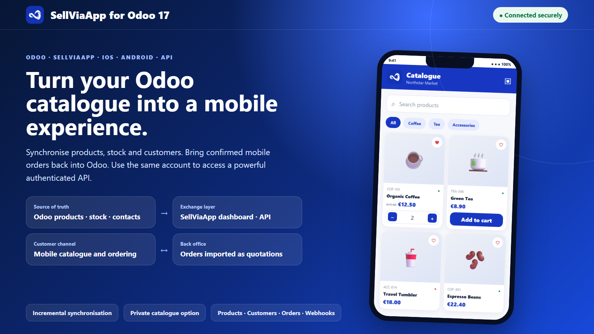
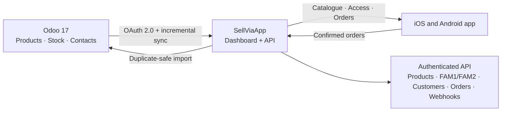

# SellViaApp Connector for Odoo 17

[](https://www.odoo.com/)
[](LICENSE)
[](https://github.com/sellviaapp/sellviaapp-odoo-connector/actions/workflows/validate.yml)

Connect one Odoo database to a tailored SellViaApp mobile app for iOS and Android and to a complete authenticated API. Keep Odoo as the source of truth for catalogue and stock, invite customers to the mobile experience, and retrieve confirmed mobile orders as Odoo quotations.



## One connection, two outcomes

The connector opens two complementary channels from the same Odoo data:

1. **Mobile catalogue and ordering** — products, categories, stock and customer access become available in the SellViaApp experience for iOS and Android.
2. **Authenticated business API** — the SellViaApp account also exposes structured resources for catalogue, FAM1/FAM2 categories, customers, carts, orders, fulfilment, payments, integrations and webhooks.

This is therefore more than a mobile front end. It is a controlled exchange layer that lets Odoo participate in a broader API ecosystem.

## Core capabilities

| Direction | Data and behaviour |
| --- | --- |
| Odoo → SellViaApp | FAM1/FAM2 categories, products, variants, descriptions, references, barcodes, prices, VAT, units, attributes, up to five images and stock |
| Odoo → SellViaApp | Contact accounts and secure mobile invitations |
| SellViaApp → Odoo | Customers, reconciled without automatically creating ambiguous duplicates |
| SellViaApp → Odoo | Confirmed mobile orders imported as draft quotations with fulfilment and payment context |

- Incremental catalogue batches of up to 250 records.
- Lightweight inventory batches of up to 500 records.
- Automatic stock refresh every 5 minutes and catalogue reconciliation every 15 minutes when enabled.
- Targeted updates for a selected product or contact.
- Stable external identifiers and payload fingerprints to avoid duplicate or unchanged transfers.
- Authentication gate enforced both in the interface and in server-side actions.
- Signed image access, revocable OAuth tokens and HTTPS enforcement in production.

## Optional private catalogue

SellViaApp can be configured as a private, non-discoverable catalogue:

- the space is hidden from the public directory;
- access is limited to accounts authorised by the business;
- administrators can manage sessions and connected devices in SellViaApp;
- compatible mobile devices can use biometric access;
- the Odoo connection remains revocable and all synchronisation stays blocked until OAuth authorisation succeeds.

The private-access policy is configured in SellViaApp. This Odoo module transports authorised business data; it does not make a catalogue public by itself.

## Data flow



## Install in 5–10 minutes

1. Download the release ZIP or clone this repository.
2. Copy `sellviaapp_connector` into an Odoo custom add-ons directory.
3. Ensure that directory is listed in `addons_path`.
4. Restart Odoo, update the Apps list, then install **SellViaApp Connector**.
5. Open **SellViaApp**, approve the displayed code, then select **Complete connection**.

The module depends on `base`, `product`, `stock`, `sale_management` and Python `requests`.

### Upgrade from the command line

```bash
odoo-bin -c /path/to/odoo.conf -d DATABASE -u sellviaapp_connector --stop-after-init
```

Restart the regular Odoo service after the upgrade.

## First synchronisation

1. Select **Synchronise catalogue**.
2. Select **Update stock**.
3. Send eligible Odoo contacts or retrieve SellViaApp customers.
4. Retrieve confirmed mobile orders when required.
5. Review counts, last-run times and technical logs in the connector workspace.

## API overview

Representative resource families are documented in [API.md](API.md). The connector itself uses dedicated `/odoo/*` endpoints; an active SellViaApp account can also provide wider authenticated endpoints such as `fam1/list`, `fam2/list`, `product/list`, `customer/list` and `order/list`.

## Repository layout

```text
sellviaapp_connector/   Installable Odoo 17 add-on
tools/                  Marketplace validation and screenshot sources
.github/workflows/      Continuous validation
API.md                  Curated API surface and connector contract
SECURITY.md             Security policy
SUPPORT.md              Support and diagnostic checklist
```

## Validation

Run the repository validator before packaging:

```bash
python tools/validate_module.py
```

It validates the manifest, required metadata, referenced files, Python syntax, XML files, CSV headers, marketplace images and common secret patterns.

## Support and licence

Read [SUPPORT.md](SUPPORT.md) before opening a support request. Security issues should follow [SECURITY.md](SECURITY.md).

The connector is distributed under the [GNU Lesser General Public License v3.0](LICENSE). A SellViaApp account and outbound HTTPS access are required for the hosted service used by the connector.
